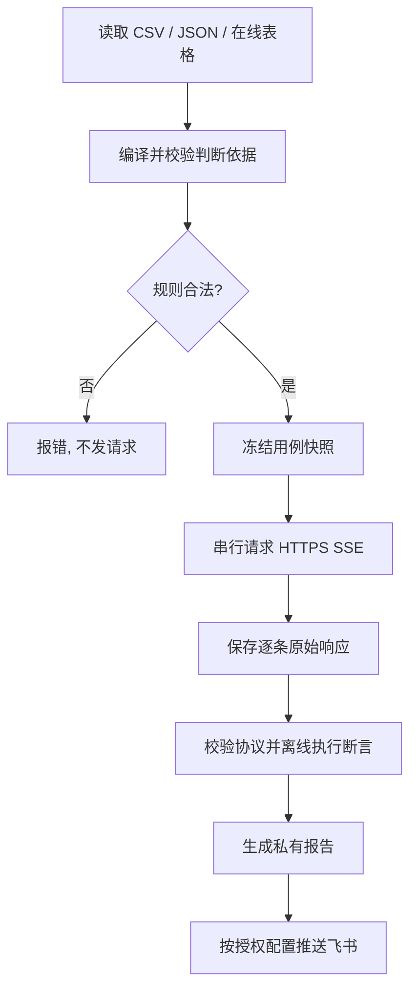

# api-sse-probe

一个可复用的 **HTTPS JSON → SSE 接口拨测 Skill**：读取测试表、逐条执行请求、保存原始响应、用确定性断言判定结果、生成私有报告，并按配置发送飞书通知。

**当前版本：2.4.3** · **Python 3.9+** · **标准库，无第三方 pip 依赖**

## 功能

- 用例输入：本地 CSV/JSON、腾讯文档只读 MCP、飞书表格只读。
- 判断依据：公共列 + 特殊列；文本包含/不包含、AND/OR、title、skillId、SDK、deeplink 和 JSON 结构化条件。
- 执行引擎：单入口、串行拨测、逐条保存原始 SSE、离线复判、可恢复运行。
- 输出结果：PASS / FAIL / ERROR、失败原因与完整本地证据；可选飞书通知和授权的脱敏云文档归档。

## 快速开始

```bash
# 在完整 Skill 目录执行
cp config.example.json config.local.json
# 编辑 config.local.json，填写自己的授权 API、鉴权和通知配置
python3 scripts/probe.py --check
python3 scripts/probe.py
```

指定其他测试表：`python3 scripts/probe.py --source-url '<已授权的完整表格链接>'`。

**注意**：示例配置没有真实 API 凭据。正式运行需要有效授权，且示例默认启用飞书通知；无获授权机器人配置时程序会拒绝正式请求。只读 `--check` 不发送业务请求或通知。

## 判断依据示例

| 公共判断依据 | 特殊判断依据 |
| --- | --- |
| `HTTP 200 / 文本回复` | `文本回复包含“暂停”或“停止”` |
| `HTTP 200 / title` | `title是“灵犀服务”` |
| `HTTP 200 / skillId` | `skillId是“VIDEO123”` |

**断言只做字面/结构化校验**：“无法暂停播放”会命中“暂停”，但不代表真实暂停成功。详情见 [断言规则](references/assertions.md)。

## 工作流



## 文档导航

- [SKILL.md：Agent 调用与安全约束](SKILL.md)
- [配置参数](references/configuration.md) · [判断依据](references/assertions.md)
- [架构实现](references/architecture.md) · [安装与排障](references/troubleshooting.md)
- [安全要求](SECURITY.md)

## 安全提醒

**绝不提交** `config.local.json`、`.env`、真实 `powerkey` / Token / Signature、内部 API URL、Webhook、设备 ID、原始 SSE 和报告。请使用自己的私有配置或环境变量。对外发布前必须检查文件内容及提交历史。

测试：`python3 -B -m unittest discover -s tests -q`。许可：MIT。