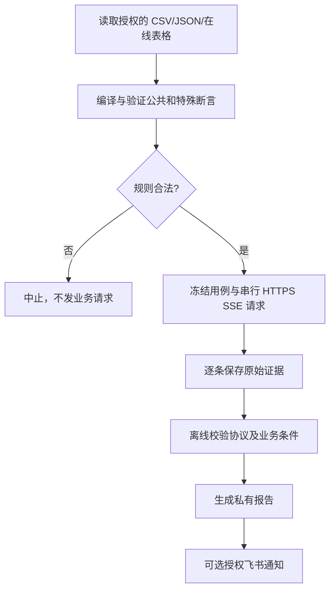

# api-sse-probe

可交给 Agent 安装的 **HTTPS JSON→SSE 自动拨测 Skill**。支持 CSV、JSON、腾讯文档和飞书表格用例；确定性规则、持久化证据、离线判定、断点续跑、私有报告与可选飞书通知。

当前版本 **2.5.0**。要求 **Python 3.9+（macOS/Linux）**，仅使用 Python 标准库；克隆源码需要 Git，**无需 pip、Node 或另外安装腾讯文档 MCP**。

## 让 Agent 安装

把仓库链接 `https://github.com/haomiaoOnline/api-sse-probe` 给可以使用本地终端/文件的 Agent，让它读取根目录的 [SKILL.md](SKILL.md)，按照安装契约操作。

手工安装示例（选择你使用的 Agent 实际 Skills 根目录）：

```bash
git clone --depth 1 https://github.com/haomiaoOnline/api-sse-probe.git
cd api-sse-probe
python3 scripts/check_skill_contract.py
python3 scripts/install.py --target "/path/to/agent/skills"
cd "/path/to/agent/skills/api-sse-probe"
python3 scripts/setup.py init --source tencent
python3 scripts/setup.py doctor
python3 scripts/probe.py --check
```

向导支持 `csv`、`json`、`tencent`、`feishu`。所有敏感信息在本机终端隐藏输入，写入受限的 `config.local.json`，不上传到仓库、Agent 对话或日志。安装器拒绝覆盖已有个人配置。

## 配置和授权

- API URL、`powerkey`、`signature`：从已授权的接口提供方获取；程序不计算动态签名。
- 腾讯文档 Token：[官方授权页](https://docs.qq.com/open/auth/mcp.html)。复制含 `tab=` 的工作表链接，确保账号有读取权限。
- 飞书应用：在[开放平台](https://open.feishu.cn/app)取得 App ID / Secret，开通授权并允许读取文件。
- 飞书群机器人：[官方自定义机器人指南](https://open.feishu.cn/document/client-docs/bot-v3/add-custom-bot?lang=zh-CN)。默认**关闭**通知，用户明确启用后才发送。

`doctor` 是**不联网**的配置检查；`probe.py --check` 会根据获授权的来源**只读读取用例**，但不会向业务 SSE API 发 POST。真实拨测只在用户确认之后进行。

## 核心流程



## 文档导航

[SKILL.md：Agent 安装与执行契约](SKILL.md) · [完整安装指南](references/installation.md) · [配置说明](references/configuration.md) · [判断依据](references/assertions.md) · [架构与工作流](references/architecture.md) · [安全规范](SECURITY.md)

离线测试：`python3 -B -m unittest discover -s tests -q`。许可证：MIT。

**安全提醒：** 不得提交 `config.local.json`、个人 Token、API 鉴权、内部 API 地址、私有文档链接、Webhook、设备 ID、原始 SSE、运行日志及报告。