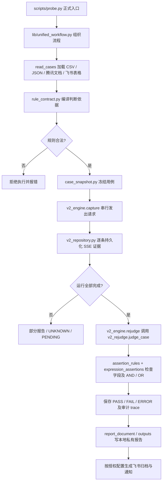

# 架构与执行工作流

本页只描述**当前运行逻辑**，不记录历史版本或开发待办。

## 流程

## 主要文件

| 文件 | 职责 |
| --- | --- |
| `scripts/probe.py` | 用户命令入口、用例读取、HTTP/SSE 解析及采集辅助 |
| `scripts/lib/unified_workflow.py` | 一次运行、续跑、选取用例、报告与通知的统一编排 |
| `scripts/lib/rule_contract.py` | 请求前确定性验证和编译规则 |
| `scripts/lib/natural_assertions.py` | 中文“包含/不包含/和/或”等显式条件 |
| `scripts/lib/expression_assertions.py` | JSON/文本 AND、OR、NOT、same_frame 执行 |
| `scripts/lib/structured_assertions.py` | 真实业务字段存在、等于、包含、前缀检查 |
| `scripts/lib/assertion_rules.py` | 从 SSE 助手业务 data 提取信号，逐条断言 |
| `scripts/lib/v2_engine.py` | 持久化串行捕获、离线判定、报告和通知 |
| `scripts/lib/v2_repository.py` | 请求意图、原始证据、摘要和运行状态保存 |
| `scripts/lib/v2_rejudge.py` | 先检查 HTTP/SSE 完整性，再汇总最终结果 |

## 必须保持的行为

1. **数据边界**：只用助手实际业务 SSE data 做业务断言；不拿用户语料、请求回显或无关元数据凑结果。
2. **规则边界**：公共判断依据和特殊判断依据合并后默认全部满足；规则内部的“或”只表示当前条件的 OR，不是整条用例放宽为 any。
3. **证据边界**：先保存完整原始字节再离线复判；SSE 不完整、`[DONE]` 缺失时不能凭部分文本判定 PASS。
4. **恢复边界**：未知请求不得无条件重发；新运行只有在启用单次 UNKNOWN 自动重试时才允许重放一次，并保留两个 reqId。
5. **安全边界**：凭据/原始数据仅在私有运行目录；飞书通知和云端归档必须遵循授权和脱敏边界。